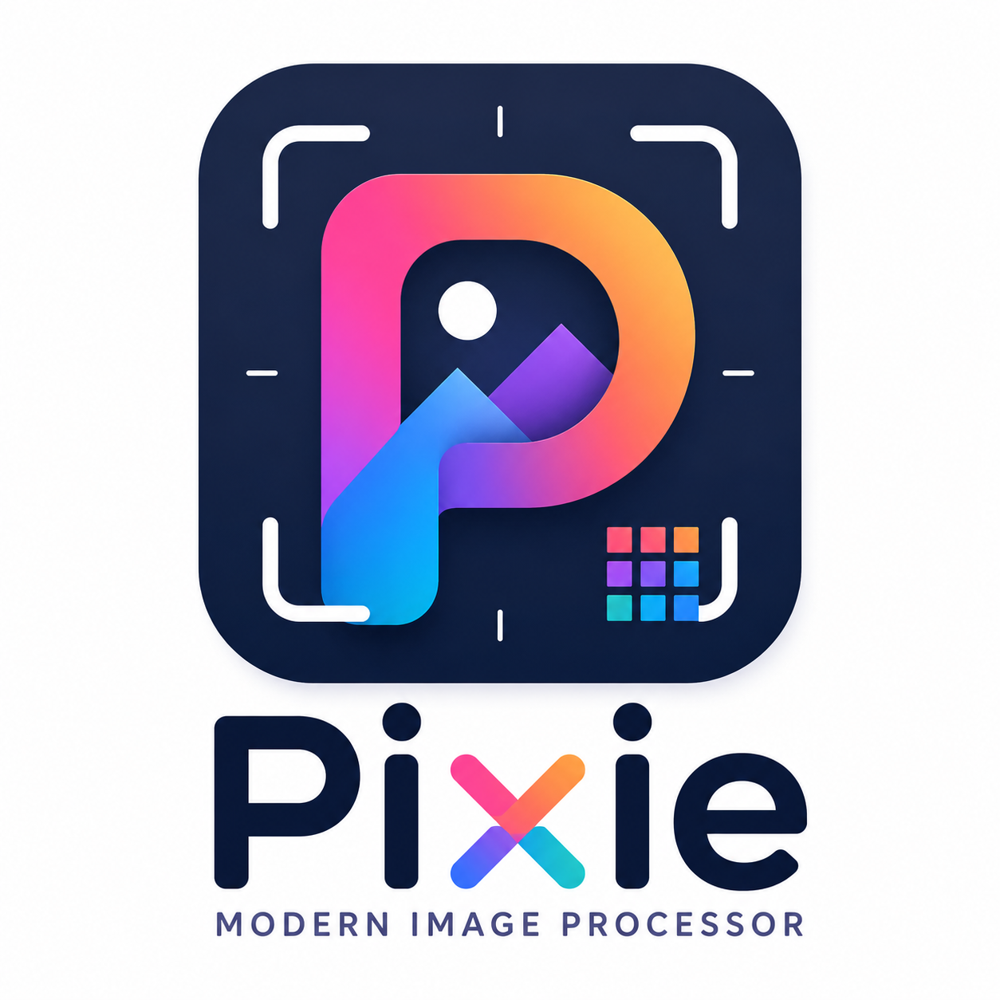

# Pixie

**Modern Image Processor**

[](https://gitlab.com/demsking/pixie/-/commits/main)
[](https://demsking.gitlab.io/pixie)
[](https://gitlab.com/demsking/pixie/-/blob/main/LICENSE)

Pixie is a modern, secure, and lightweight GTK4 image processor built with Rust.
It provides focused tools for cropping, resizing, rotating, flipping, and
converting images without the complexity of a complete graphics editor.



## Features

- **Responsive GTK4 Interface**: Built using Libadwaita conforming to GNOME Human Interface Guidelines.
- **Non-Destructive Pipeline**: Edits are stored as an operation stack; full-resolution rendering is lazy.
- **Secure File Decoding**: Pre-verifies image headers to prevent decompression bombs.
- **Interactive Cropping**: Free aspect ratio, circle crop, standard ratios (1:1, 5:4, 4:3, 3:2, 16:9), and optional rule-of-thirds grid.
- **Checked Resizing**: Prevent enlargement, aspect ratio locking, and high-quality Lanczos3 interpolation.
- **Accurate Rotations**: Lossless 90/180-degree rotations, arbitrary angle rotations with canvas expansion and custom backgrounds.
- **Metadata Protection**: stripping GPS and camera details by default to protect privacy.
- **Keyboard Shortcuts**: Common operations bound to simple shortcuts.

## Supported Formats

- PNG
- JPEG
- WebP
- BMP
- TIFF
- Static GIF
- AVIF (native support)

## Installation & Setup

### 1. Devbox Setup (Recommended)

Make sure you have [Devbox](https://www.jetify.com/docs) installed.

```bash
git clone git@gitlab.com:demsking/pixie.git
cd pixie
devbox install
devbox run bootstrap
devbox shell
make check
make test
make run
```

### 2. Manual Setup (Without Devbox)

#### Fedora Setup
```bash
sudo dnf install gtk4-devel libadwaita-devel pkgconf make rustup
rustup-init
make bootstrap
```

#### Debian or Ubuntu Setup
```bash
sudo apt install libgtk-4-dev libadwaita-1-dev pkg-config make rustup
rustup-init
make bootstrap
```

### 3. Flatpak Setup
```bash
make flatpak-build
make flatpak-run
```

## Documentation

The complete documentation is available at:

https://demsking.gitlab.io/pixie

## Contribute

Please follow [CONTRIBUTING.md](https://gitlab.com/demsking/pixie/blob/main/CONTRIBUTING.md).

## Versioning

Given a version number `MAJOR.MINOR.PATCH`, increment the:

- `MAJOR` version when you make incompatible API changes,
- `MINOR` version when you add functionality in a backwards-compatible manner,
  and
- `PATCH` version when you make backwards-compatible bug fixes.

Additional labels for pre-release and build metadata are available as extensions
to the `MAJOR.MINOR.PATCH` format.

See [SemVer.org](https://semver.org/) for more details.

## License

GNU GENERAL PUBLIC LICENSE
Version 3, 29 June 2007

    Copyright © 2026 Sébastien Demanou <demsking@gmail.com>

Everyone is permitted to copy and distribute verbatim copies
of this license document, but changing it is not allowed.

You may obtain a copy of the License at
[LICENSE](https://gitlab.com/demsking/pixie/blob/main/LICENSE).
