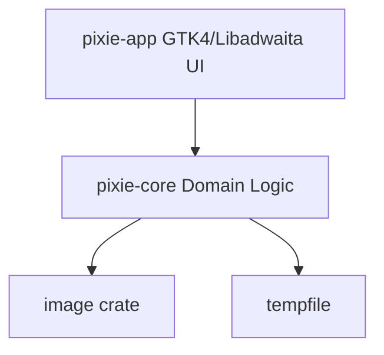

# Architecture

Pixie is structured as a Rust cargo workspace to enforce clean separation of concerns.



## Workspaces

1. **`pixie-core`**: A headless library containing image transformations, metadata processing, history tracking, and input validation. It does not import GTK, GLib, or Cairo.
2. **`pixie-app`**: A desktop application that builds the GTK4 user interface, manages shortcuts, spawns worker threads, handles file pickers, and maps widget scales.

## Domain & Pipeline Model

Image operations are modeled non-destructively as a sequence of enum descriptors:

```rust
pub enum ImageOperation {
    Crop(CropOperation),
    Resize(ResizeOperation),
    Rotate(RotateOperation),
    Flip(FlipOperation),
    CircleMask(CircleMaskOperation),
    Flatten(FlattenOperation),
}
```

The `PixieDocument` holds the unmodified original decoded buffer and an `EditingHistory` stack. When a new operation is applied, it is pushed onto the stack. The current output image is generated on-demand by piping the original buffer through the active operations list (`OperationPipeline`).

## Background Worker & GTK Main-Thread Constraints

To keep the UI responsive at 60 FPS, all CPU-heavy tasks (decoding, rendering, encoding) are delegated to background threads:

1. **Task Spawning**: `ImageWorker` spawns threads and passes a cloned GLib channel sender.
2. **Cancellation & Stale Rejection**: An active generation ID is incremented whenever a new command is queued. Completed tasks with matching generation IDs are accepted; others are ignored.
3. **Thread Safety**: Workers notify the main context via `glib::Sender`. All widget modifications take place strictly on the GTK main thread.
